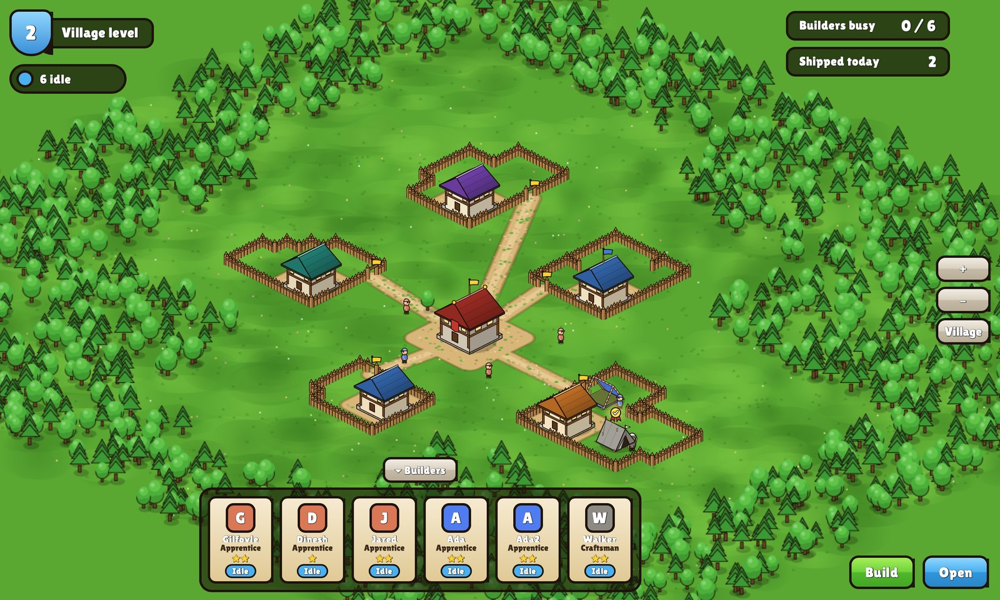

<p align="center"></p>

<h1 align="center">Clash of Claudes</h1>

<p align="center"><b>Run all your coding agents from one village.</b> · <a href="https://clashofclaudes.crevn.xyz">clashofclaudes.crevn.xyz</a><br>
Claude Code, Codex, Antigravity CLI, OpenCode and Grok Build sessions as builders raising tents in an isometric town.</p>

<p align="center">


</p>



A macOS desktop app for people who run several coding agents at once. Every workspace is a walled compound in an isometric village, and every running agent session is a builder raising a structure inside it. You see at a glance which agents are working, which need you, which are stuck and which have finished. The real terminal is always one click away.

v1 is Mac only (macOS 13 or later, Apple Silicon and Intel). Free and open source under the [GPL 3.0](#license) (the art has its own terms).

**Why:** with three or four agents running in different repos, terminal tabs stop telling you which one is waiting on a permission prompt and which one finished ten minutes ago. Here the answer is on screen: a builder hammering away is working, a "!" bubble needs you, a medal means it shipped. Allow or deny a permission right from the village, or click through to the real terminal.

## Install

1. Download **[Clash-of-Claudes.dmg](https://github.com/fabianferno/clashofclaudes/releases/latest/download/Clash-of-Claudes.dmg)** (the newest release, from the public [releases repo](https://github.com/fabianferno/clashofclaudes/releases)).
2. Open the DMG and drag **Clash of Claudes** onto **Applications**.
3. Launch it from Applications. Releases are signed and notarized, and the app updates itself.

An unsigned build (made from source without Apple credentials) is not notarized, so macOS blocks it. Try to open it once, then go to **System Settings > Privacy & Security** and click **Open Anyway**.

To ship a release, see [docs/release.md](docs/release.md).

## First run

- The first launch opens a welcome that asks what to call you; the Town Hall's plate then reads "<name>'s Town Hall" (change it in **Settings › Your village**). It offers a two-minute tour on a sample compound that exists only in memory: you raise it, start a sample session, answer its permission prompt, review it and accept it, and see the terminal, Kanban, resources and roster, without any files changing or agents running. Skip it any time; **Replay the tour** in Settings brings it back.
- The window opens on an empty village with a welcome card. Click **Open workspace** (or **Open** at the bottom right, or use the Town Hall) and pick your project. It becomes a compound. **New workspace** (or **Build**) starts an empty one.
- Open the **Town Hall** to see which agent CLIs were found on your Mac, their versions, and copyable install and sign-in commands for the ones that are missing (Claude Code's native installer, Homebrew or npm; Codex via npm or Homebrew; Antigravity CLI's and Grok Build's install scripts; OpenCode via npm). A greyed-out agent in **+ New session** opens the same steps. **Check again** re-detects after you install one.
- Click a compound to open its Workspace panel, then **+ New session**. Pick a builder, an agent, and optionally a model, effort and a first task. The agent starts in a real terminal in that workspace.
- Click any builder or structure to open its live terminal in the side panel. The terminal can be popped out to a larger view.
- **+ Terminal** in the same panel opens a plain shell in the workspace.
- Closing the window does not quit: your builders keep working, and the app stays in the menu bar and the Dock. Click either to bring the window back. **⌘Q** (or **Quit** in the menu bar's menu) quits.

The app does not install agents, log in for you, or manage API keys. Each agent uses the login you already set up for it.

## Supported agents

| Agent | What the app can report | Approve / deny from the app |
|---|---|---|
| Claude Code | Working, needs you (permission request), finished, tool-step count. Also detects the first-run "trust this folder" menu. | Yes |
| Codex | Working, finished (turn complete). Needs you is detected from the on-screen approval and trust prompts. **For app sessions, Codex's `notify` and `developer_instructions` settings are overridden** (`-c notify=…`, `-c developer_instructions=…`): a `notify` program or developer instructions you set in `~/.codex/config.toml` do not apply in sessions started from the app (your file is never edited). | No: answer in the terminal |
| OpenCode | Working, needs you (permission request), finished, stuck on error. The shared-folder note is only delivered when you give a task (it is prefixed to the first prompt). | No: answer in the terminal |
| Antigravity CLI (`agy`) | Working, needs you (permission or question), finished, stopped after an interrupt, failed, tool-step count, read from the status reports agy writes into its own terminal output (no settings files at all). The shared-folder note is only delivered when you give a task. | Yes (Enter / Esc) |
| Grok Build (`grok`) | Working, needs you (permission, question or the folder-trust screen), finished, failed (with Grok's reason, such as a usage limit), tool-step count, read from the status reports Grok writes into its own terminal output (OSC 7501; the app answers Grok's "does this terminal show status?" query, so no settings files at all). Subagents don't change the session's status. The shared-folder note is passed with `--rules`. Models and their effort levels come from Grok's own cache of your account's list (`~/.grok/models_cache.json`, read only). | No: answer in the terminal |
| Custom command | Working while it prints, finished after quiet time, stuck if it exits non-zero or is silent for long. | n/a |

For Codex, OpenCode, Antigravity and Grok Build, a session that goes quiet before the agent has reported anything (typically a login, auth or first-run screen) shows **Needs you: "Waiting in the terminal"**, never Finished. Codex's models come from Codex itself (`codex debug models`): the picker shows the ones Codex lists, by name, with each model's own effort levels; an older Codex without that command falls back to typing a model id. OpenCode has no model list: type `provider/model`, or leave it empty for its default.

Claude Code and Antigravity CLI have been verified against real runs. Grok Build's launch flags, trust screen and status reports were checked against Grok Build 1.0.77; a finished turn and its tool-permission prompt come from Grok's documentation. Codex and OpenCode support was written from their documentation and is waiting for real-world confirmation; if one misbehaves the terminal always works. Model and effort are passed only where the agent documents a way to do it. Elsewhere they are recorded on the builder for display.

Antigravity CLI replaced Gemini CLI for Google's plans; the app supports Antigravity and no longer Gemini CLI (builders saved for Gemini CLI become Antigravity builders).

## One thing at a time

Running several agents makes it easy to start a fifth thread while four are still waiting on you. The village keeps that in check:

- **Your queue.** Every session waiting on you goes in one queue, in this order: permissions to Allow or Deny, then questions, then stuck sessions, then finished work to review. Oldest wait comes first within each. **▶ N waiting on you** at the top left (or **⌘J**) opens the first item. Deal with it and the next one comes up.
- **A briefing for each item.** Before the terminal, the panel shows the task, what the agent asks (for Claude Code, the exact tool call, such as `Bash: npm test`) and the agent's last reply (Claude Code and Codex). It also shows the files changed since the session started. When the agent points to a markdown doc it wrote (a plan or a spec, named in its last reply or among the changed files), click the path to read it rendered in the panel, follow links inside it, and approve it or ask for changes from the same card. **Open in editor** opens it in your editor instead.
- **Close the loop.** For finished work: **Accept** closes it and counts it as shipped: its workspace's house livens up with the work shipped there in the last couple of weeks and settles back down when work stops. **Follow up** sends your reply into the agent's prompt. **Park** puts it aside, with an optional note, until it changes. **Discard** closes it without counting it, and its changes stay on disk.
- **Fewer threads.** While things wait on you, **+ New session** suggests **Add to To Do** instead. **Settings › Focus** can limit how many sessions work at once.
- **Elixir that decides.** The collectors forecast each agent's limits at the rate they are burning ("runs out around 3:40 PM, before it refills"): in the collector panel, on the resource bar (its rim glows amber) and once as a notice. To Dos set to start on their own wait while their agent is at or under a reserve (**Settings › Elixir**, 10 % by default), and start once it refills; optionally a free builder whose agent has elixir takes the task instead.
- **A To Do that runs itself.** Tick **Start on its own** on a To Do and it starts when its builder is free and the limit allows. Tick **Own worktree** (on a To Do or in + New session) and the session starts in a new git worktree, on a new branch from your last commit. The worktree is kept in the app's data folder (`worktrees/`). Its changes stay apart from yours until you merge the branch. Uncommitted changes in your folder are not carried over.
- **Notes for later.** Each workspace's panel has a notepad for ideas and reminders that aren't tasks yet ("add export later"). It saves as you type, in the app's data only. **Move to To Do** moves the selected text, or the line the cursor is on, to the To Do. **Start a session** starts one with it as the task. A small scroll on the house's name plate shows which workspaces have notes.

## Raid report

**Raid report** (in the Town Hall panel, or ⌘K) shows your day on one card: the tasks you accepted, the lines they changed, and how long builders waited on you, added up over builders. After 6 PM the top bar offers it once a day, if anything happened. **Export PNG** saves the card to your Downloads folder. The app keeps a week of this in `raid.json` in its data folder and never sends it anywhere. Lines changed and wait times are recorded from the version that added the report onward.

## Notifications

When the app is in the background, it shows a macOS notification when a session needs you or finishes (title: the builder's name, body: "needs you: ..." or "finished"), and the Dock icon shows how many sessions wait on you: the same count as **▶ N waiting on you**, so stuck sessions count, and parked or paused ones do not. Clicking a notification brings the app forward and selects that session. When a Claude Code or Antigravity session asks for permission, the notification has an **Allow** button that answers that one prompt without opening the app; if the prompt was already answered or a newer one is open, the click opens the session instead. To deny, click the notification and use the briefing. Notifications never include your task text or terminal output.

Over each structure, a builder waiting on you (or stuck) shows for how long ("Waiting for you · 7m"), and **▶ N waiting on you** shows how long the longest-stopped builder has waited.

## Day and night

The village follows your clock. Sunrise around 6:30 AM brings a golden light from the left, and sunset around 6:30 PM brings it from the right. From 7 PM the light fades to night, when houses light up and fireflies come out. Morning returns by 7 AM. The hours are fixed: the app never asks where you are. Turn it off in **Settings › Your village**.

## Menu bar and mini village

The village does not have to be in front for you to see who waits.

- **Menu bar.** The crossed swords in the menu bar show how many sessions wait on you. Their menu lists the queue in its order (up to ten): the builder, what it waits on, and for how long. A Claude Code or Antigravity session asking for permission has **Allow** and **Deny** right there, and they answer without bringing the window forward; anything else opens in the village. A permission's row shows the tool call it asks about (`Bash: npm test`), cut to 60 characters. Rows never show your task text.
- **⌃⌥⌘J, from any app,** opens the first item of your queue (or just the village when nothing waits). Turn it off in **Settings › Notifications**; the same place says so when another app holds those keys.
- **Mini village.** **Mini Village** in the menu bar's menu (or in ⌘K) opens the village alone in a small panel that floats above other apps, on every Space and over full-screen apps. Clicking in it never takes the keyboard from the app you are typing in. Click a builder or a structure to open it in the main window. It shows compounds, structures and builders (not app boards), remembers where you left it, and comes back on the next launch if it was open.

## Team (Vercel Board)

If you have a Vercel team, the village can show on its [Board](https://vercel.com/docs/board), Vercel's message board for people and coding agents. It is off until you turn it on.

- **Turn it on** in **Settings › Team (Vercel Board)**. It uses the `vercel` CLI and login you already have: the CLI must be recent enough to have the `board` command (`npm i -g vercel@latest`), and you must be signed in (`vercel login`). Settings says which of these is missing, with the commands, and **Check again** looks anew. The app never sees your Vercel token.
- **Share a workspace** with **Share on the team board** in its panel (each workspace has its own switch; **Share new workspaces** makes new ones start shared). Each agent session of a shared workspace is then one thread in the channel `v/<your Vercel username>/w/<workspace>`, on a board named `village` (you can pick another team or name). The thread's labels say how the session stands (`coc.state`: working, needs_you, finished, stuck, paused, closed), and a reply is added each time it starts waiting on you or finishes.
- **Share details** (on by default) also writes what the builders work on: the task, the tool call a builder asks about, its questions, its last reply and the names of the files it changed. Turn it off and only who is working, waiting or done is written.
- **Builders write under their own name.** A session in a shared workspace gets `BOARD_PROFILE` and `BOARD_URL` in its environment, so an agent that uses `vercel board` itself posts to the same board as "wizard via you".
- Read it from anywhere with `vercel board read v/<you>/w/<workspace> --name village`.
- A slow, unreachable or signed-out board never holds a session up: writes happen in the background and are tried again later.

Visiting teammates' villages and lending builders build on this and come later.

### Team villages

Each person on a Vercel team has their own village. You decide who sees yours, and you can walk into the ones you were invited to.

- **Private village** (Settings › Team) closes your village on the board to everyone you did not invite. It is turned on the first time Settings sees the board connected. Under the switch, Settings always says who can see your village right now, read from the board itself.
- **Only an owner of the Vercel team can close a village.** If you are a member, the switch is read-only and Settings gives you the command for an owner to run. Until one does, everyone on the team can see your village.
- **People.** Invite a teammate by their Vercel email, as a Visitor, Helper or Trusted, for all your shared workspaces or some. A Visitor looks. A Helper can also answer a builder's question and send it a follow-up. A Trusted person can also Allow and Deny its tool calls.
- **Pairing their Mac.** Nobody acts in your village until you have paired their Mac. Next to a Helper's or Trusted person's invite, press **Pair their Mac** and send them the code it shows (it lasts 5 minutes). They visit your village, press **Enter pairing code**, and read you the number their Mac shows; if Settings shows the same number, press **Confirm**. Only their own Vercel login can use the code. Changing their level in People takes effect at once, and removing the invite unpairs their Mac.
- **What you see.** Settings › People says who last did what ("bob allowed `npm test`"), and the builder's thread on the board keeps the record. Your Mac checks every action against its own list of paired Macs and their levels, whatever the board allows, and an answer only ever applies to the prompt it was shown for.
- **Visiting.** The villages you were invited to appear as a row at the top left, each with the number of builders waiting there. Click one to see it as its owner laid it out, under a ribbon that says whose it is, and press **Home** to come back. Your own sessions keep running, and your queue and notifications stay yours. Click a builder there to read what it works on and what it waits for; if that village's owner paired your Mac, the answers your level allows are there to press. Your Mac signs each one with a key it keeps in your Keychain.

Two things to know:

- **Your own agents can reopen your village**, because they run with your Vercel login and so can change the board's access rules. They cannot act in anyone's village. Settings checks the rules when it opens and offers **Put it back** when they are not what you set.
- **With the phone remote set up, whoever can deploy the `village-remote` project can read every private village that lets the remote in.** Settings names this in "who can see this village".

### Lending and borrowing builders

A teammate whose Mac you paired can hand one of your builders a task, and you theirs.

- **Lend** a builder in **Settings › Team › Lent builders**: to everyone whose Mac is paired or to chosen people, in every shared workspace that can be lent or chosen ones, down to an elixir floor. A workspace can be lent when it is a git repository with a commit and an `origin`. A borrow starts on its own and tells you; turn on **Ask me first** to accept the first task yourself (follow-ups after it go straight to the builder).
- **Borrow** while visiting a teammate's village: click one of their workspaces' houses, pick a builder they lend you, write the task, **Send**. **Borrowing**, at the top right, shows what came back and the builders working for you; they also stand in a **guest camp** in your own village.
- **Where it runs.** On the lender's Mac, in a worktree of its own, on a new branch cut from what `origin` has (never from the lender's own unpushed work). The borrower answers its questions and sends follow-ups; Allow and Deny go to the lender unless the borrower is Trusted there. Nobody else may act on it.
- **When it finishes**, the lender's Mac pushes that branch, and only it, to `origin`: never forced, and never over a branch of the same name. The borrower presses **Done**, which closes the session; the worktree is removed only when nothing in it would be lost, and the branch is kept.

**Know this before you lend.** A borrowed task is a teammate running an agent on your Mac, with your logins, your repository and your elixir, and the push uses your git credentials. Lend only to people you would give that. "Ask me first" shows you the first task; it does not make the rest safe. Starting from `origin` keeps your unpushed work out by accident, not by force: the worktree shares your repository, so a task could still reach your local branches and push them with your credentials. The app's own push runs no git hooks, so nothing the borrowed work writes runs at push time. Removing the worktree after Done deletes files git ignores there (a `.env`, a local database).

### Phone remote

Answer your builders from your phone. A small web app, the remote, runs on your team's own Vercel account; your Mac listens to the board and applies what a paired phone sends, as if you had clicked in the window. It is off until you set it up, and separate from the switch above.

- **Set it up** in **Settings › Team › Phone remote**, once Vercel Board is connected. **Deploy the remote** puts the app this version carries on your team as the project `village-remote`, with your own `vercel` CLI. If a teammate already did, you get **Use the team's remote**: one remote serves every village on the team's board.
- **Pair a phone.** Press **Pair a phone**: Settings shows a QR code and a twelve-character code, good for 5 minutes. Scan the QR with the phone, or open the remote there and type the code. Then check that the phone and the Mac show the same check number before you press **Confirm** on the Mac. On an iPhone, add the page to the Home Screen first, open it from there and type the code (an iPhone sends notifications only to Home Screen pages). The code is the secret that pairs: it is never written to the board or sent to the remote, so only a phone you showed it to can pair.
- **What the phone can do:** Allow or Deny a permission prompt, answer a question (pick an option or type), and send a follow-up to a builder that is stuck or finished. A tap answers only the prompt it was shown for; if the builder moved on, the phone says "Too late". Pickers with several questions, starting sessions and accepting finished work stay on the Mac.
- **Notifications.** Turn them on from the phone's page. A notice goes out when a builder starts waiting; Vercel wakes the remote for it, which took between 5 and 60 seconds when measured.
- **Paired phones** are kept in your macOS Keychain, with their names and when each was last used. **Remove** unpairs one at once.

**Know this before you rely on it.** The phone's key lives in the browser, and the remote's own page is what uses it. So whoever can deploy to the `village-remote` project on your Vercel team can make that page act as your phone: a teammate with deploy rights, or one of your own agents, since they run with your Vercel login. Your Mac watches for production deployments it did not make and pauses the remote until you press **Trust it**, which narrows this and does not close it. Do not pair a phone on a team whose members you would not let approve commands on your Mac.

## Sounds

The app plays a sound when a builder wants a decision, asks you something, finishes, gets stuck, starts, sends out a minion (subagent) or goes back to work, and when you accept finished work, for every agent and whether the window is in front or not. Pick a macOS sound or one of your own files for each moment in **Settings › Sounds** (a copy of your file is kept in the data folder), set the volume, or turn sounds off. The app plays them itself (`afplay`); it adds nothing to your agents' hooks.

**Village ambience** (off until you turn it on in **Settings › Sounds**) is a quiet bed under those sounds that follows the time of day: wind and birds by day, with a chorus at dawn, and crickets at night. The window makes it itself (Web Audio, no sound files). It plays only while the window is open: softer while another app is in front, silent while the window is hidden or minimized.

## Privacy

- The app makes **no network connections** except these:
  - **The update check**, which you can turn off in Settings (the gear at the top right, or ⌘,). Development builds (`pnpm app`) never check.
  - **Reports you choose to send** (Help › Report a Bug…, Help › Request a Feature…, Settings › Beta feedback). A report holds what you type, app and system details (app, macOS and agent versions, counts of workspaces and sessions, and the last error the app showed, if any; never workspace names or tasks) and, only if you tick it, a screenshot. You see all of it before sending. It goes to the project's Discord.
  - **Vercel Board, only if you turn it on** (Settings › Team): for each workspace you share, the state of its agent sessions and, with Share details on, their tasks, tool calls, the agent's last reply and changed file names go to your Vercel team's board through your own `vercel` CLI. Board stores them in the United States, and your Vercel team can read them.
  - **Your village's map, with Vercel Board on**: where your shared workspaces stand, their names and how busy their houses are, your builders' names, and each session's state. Only the people who can see your village on the board can read it (see Team villages).
  - **The phone remote, only if you set it up** (Settings › Team › Phone remote): the remote reads the same board, as its own Vercel project on your team. It adds to the board each paired phone's name and public key, the address its notifications go to, and every action a phone sends. Notifications pass through the phone maker's push service (Apple, Google or Mozilla) and carry the builder's name, the workspace and, with Share details on, the command or question.
  - **Anonymous usage counts, only if you turn them on** (the welcome, or Settings › Data & privacy; off until you do). Each is one of a fixed few: the app opened (with how many workspaces and builders), a session or terminal started (and which agent), a permission prompt allowed or denied, the Kanban opened. Each carries the app and macOS versions, the chip, and a random id made when you turn sharing on and deleted when you turn it off. Never names, paths, tasks, prompts or output. They go to PostHog's EU cloud.
- A build you make from source has no bug reporting and sends no usage counts unless you give it your own keys (`COC_BUG_WEBHOOK`, `COC_POSTHOG_KEY`; see `src-tauri/build.rs`).
- Agent output never leaves your machine. Prompts, file names and folders don't either, unless you turn on Vercel Board with Share details (above).
- The menu bar's menu shows, for a session waiting on a permission, the tool call it asks about. That can be a command, a file path or a URL, so it is on screen while the menu is open. It is never in a notification.
- To list Codex's models the app runs `codex debug models`; Codex may refresh that list from OpenAI with your own Codex login, as it does when you run it. The app itself sends nothing.
- The app **never edits your agent configuration**: nothing under `~/.claude`, `~/.codex`, `~/.gemini`, `~/.config/opencode`, `~/.grok`, or a project's `.claude`, `.codex`, `.gemini`, `.opencode` or `.grok`. To get status events it hands each agent a private per-session settings file stored in the app's own data folder (`~/Library/Application Support/dev.clashofclaudes.desktop/sessions/`), and deletes it when the session closes.
- Status events arrive on a localhost-only server protected by a random per-session token.
- **Own worktree** is the one time the app writes to your repository: it runs `git worktree add` with a new `coc/…` branch. The worktree and the branch stay after the session closes, so you can merge or delete them yourself.
- Quitting the app stops your agent sessions (it asks first if any are running). They come back paused on the next launch, where they stood: **Resume** continues a Claude Code, Codex, Antigravity or Grok Build session on its own conversation (`claude --resume`, `codex resume`, `agy --conversation`, `grok --resume`); OpenCode, custom agents and terminals start fresh in the same folder. To find an Antigravity session's conversation the app reads (never writes) `~/.gemini/antigravity-cli/history.jsonl`; a Grok Build session is started with its own id (`--session-id`), and the app only checks that Grok saved it under `~/.grok/sessions`.
- macOS may ask whether Clash of Claudes can read your Downloads, Desktop or Documents folder. That is an agent or terminal running inside the app (macOS asks on behalf of the app that started it), the same prompt iTerm or VS Code shows the first time. Allow it for folders that hold your workspaces; saying no elsewhere is safe. Change it later in **System Settings > Privacy & Security > Files & Folders**.

## Development

Three ways to run it, fastest first:

- `pnpm app`: development mode. Frontend edits show up instantly, and Rust edits rebuild and relaunch the window by themselves. It keeps its own data (`~/Library/Application Support/dev.clashofclaudes.app.dev`), so experiments never touch your real workspaces; `COC_DATA_DIR= pnpm app` uses the real data (quit the installed app first).
- `pnpm app:install`: a real installed app for this Mac only, in `/Applications`, about 40 s from scratch and seconds after a small change. Use it for what only an installed app does: launching from the Dock, notifications, macOS permission prompts. If the app is open, it waits for you to quit it.
- `pnpm release`: the universal (Intel + Apple Silicon) DMG for other people. Slow (full optimization, both architectures); only for shipping.

```
pnpm install
cargo test --manifest-path src-tauri/Cargo.toml
pnpm vitest run && pnpm exec tsc --noEmit
node --test scripts/*.test.mjs
```

Design and plans are in `docs/superpowers/`. Verification results and the owner checklist are in `docs/verification/plan-3-v1.md`.

The landing site (https://clashofclaudes.crevn.xyz) is its own Astro project in `site/`, with its own `pnpm install`. Pushing to `main` deploys it on Vercel whenever something under `site/` changed; its design record is `site/DESIGN.md`.

## Contributing

Bug reports, agent-support fixes and art are welcome. See [CONTRIBUTING.md](CONTRIBUTING.md) for setup and the ground rules (the big one: the app never edits your agents' own configuration). Security issues: [SECURITY.md](SECURITY.md).

## License

The code is free software under the [GNU General Public License, version 3](LICENSE) or (at your option) any later version. Use it, study it, change it and share it; if you distribute a modified version, you must share its source under the same license.

**The art is not GPL.** The painted village, the app icon, the logo and the site's images and videos are © Fabian Ferno, all rights reserved: you may build and run the app with them and share unmodified copies of this repository, but a fork you distribute must bring its own art, name and icon (the app draws the village procedurally without the painted files). Details: [ASSETS-LICENSE.md](ASSETS-LICENSE.md).

Fonts and icons from others keep their own licenses: see [THIRD_PARTY_NOTICES.md](THIRD_PARTY_NOTICES.md).
